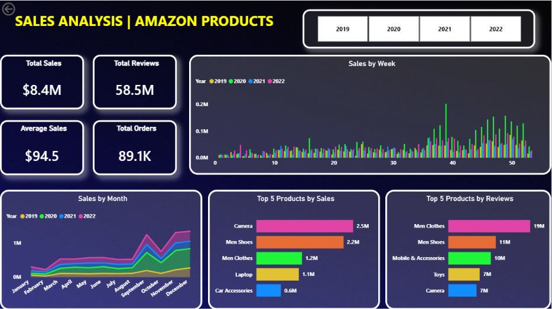

# 🛒 Amazon Products Sales Analysis

An interactive **Amazon Products Sales Analysis Dashboard** built using **Microsoft Power BI** to analyze product-level sales data and uncover meaningful business insights through interactive visualizations and KPIs.

---

## 📊 Project Overview

This project focuses on analyzing Amazon product sales data to understand product performance, sales patterns, pricing, and other key business metrics.

The project uses **Excel** as the data source and **Power BI** for data modeling, analysis, visualization, and dashboard creation.

The final output is an interactive Power BI dashboard designed to make Amazon product sales data easier to understand and explore.

---

## 🎯 Objectives

The main objectives of this project are:

- Analyze Amazon product sales data
- Identify important sales and product performance trends
- Compare products based on key metrics
- Create meaningful KPIs for business analysis
- Build interactive and user-friendly visualizations
- Present insights through a professional Power BI dashboard

---

## 🛠️ Tools & Technologies

| Tool | Purpose |
|------|---------|
| **Microsoft Excel** | Data storage and preparation |
| **Power BI** | Data modeling, analysis, and dashboard creation |
| **DAX** | Creating calculated measures and KPIs |
| **Power Query** | Data transformation and cleaning |

---

## 📂 Project Files

```text
sales_analysis_amazon_products/
│
├── Amazon_Combined_Data.xlsx
│   └── Amazon product sales dataset
│
├── sales_analysis_amazon_products.pbix
│   └── Power BI dashboard file
│
├── Dashboard_sales_analysis_amazon_products.png
│   └── Dashboard preview
│
└── README.md
    └── Project documentation
```

---

## 📈 Dashboard

The Power BI dashboard provides an interactive way to explore Amazon product sales data.

### Dashboard Preview



---

## 🔍 Key Analysis Areas

The dashboard focuses on understanding Amazon product performance through different analytical perspectives, including:

### 📦 Product Analysis

- Product-level performance
- Comparison between products
- Identification of high-performing products
- Analysis of product-related sales metrics

### 💰 Sales Analysis

- Overall sales performance
- Sales comparison across products
- Identification of important sales trends
- KPI-based performance monitoring

### 📊 Performance Analysis

- Comparison of key business metrics
- Identification of top-performing products
- Understanding sales distribution
- Interactive filtering for deeper analysis

---

## ⚙️ Data Preparation

The Amazon dataset was prepared using **Microsoft Excel** and **Power Query** before being used for dashboard development.

The data preparation process includes:

1. Importing the Amazon dataset
2. Reviewing the available columns and data types
3. Cleaning and transforming the data
4. Handling inconsistencies where required
5. Preparing the dataset for Power BI
6. Loading the prepared data into Power BI

---

## 📐 Power BI & DAX

Power BI was used to create the data model and interactive dashboard.

DAX measures were created to calculate important business metrics and support dynamic dashboard analysis.

Example:

```DAX
Price = SUMX(Data, Data[UnitPrice] * Data[Quantity])
```

These calculations help convert raw data into meaningful business metrics.

---

## 🎨 Dashboard Features

The dashboard is designed with an interactive approach and includes:

- 📌 KPI cards
- 📊 Charts and graphs
- 🔎 Interactive filtering
- 📈 Product performance analysis
- 📋 Data-driven visual summaries
- 🎯 Business-focused dashboard layout

---

## 💡 Key Insights

The dashboard can be used to identify:

- Which products perform better in terms of sales
- How sales are distributed across products
- Products that contribute significantly to overall performance
- Patterns and trends within the Amazon product dataset
- Areas that may require further business analysis

> **Note:** Specific numerical insights depend on the filters and selections applied within the Power BI dashboard.

---

## 🚀 How to Use the Project

### 1. Clone the Repository

```bash
git clone https://github.com/Sakshi-Singh-17/sales_analysis_amazon_products.git
```

### 2. Open the Project

Open the downloaded project folder.

### 3. Open the Power BI Dashboard

Open:

```text
sales_analysis_amazon_products.pbix
```

using **Microsoft Power BI Desktop**.

### 4. Explore the Dashboard

Use the available filters, charts, and visualizations to interact with the Amazon sales analysis.

---

## 📋 Dataset

The project uses:

```text
Amazon_Combined_Data.xlsx
```

The Excel workbook acts as the primary dataset for the Power BI analysis.

---

## 🧠 Skills Demonstrated

This project demonstrates practical skills in:

- Data Analysis
- Data Cleaning
- Data Transformation
- Microsoft Excel
- Power Query
- Power BI
- DAX
- Data Visualization
- Dashboard Development
- KPI Development
- Business Intelligence

---

## 📌 Project Workflow

```text
Raw Amazon Data
       ↓
Microsoft Excel
       ↓
Data Cleaning & Transformation
       ↓
Power Query
       ↓
Power BI Data Model
       ↓
DAX Measures
       ↓
Interactive Dashboard
       ↓
Business Insights
```

---

## 🔮 Future Improvements

Possible improvements for the project include:

- Adding more advanced DAX measures
- Adding time-based sales analysis
- Creating additional product-level KPIs
- Adding customer segmentation
- Adding geographic analysis
- Implementing sales forecasting
- Adding drill-through pages
- Improving dashboard interactivity
- Adding automated data refresh

---

## 👩‍💻 Author

**Sakshi Singh**

Data Analytics / Business Intelligence Project

---

## ⭐ Support

If you find this project useful, consider giving the repository a ⭐ on GitHub.

---

## 📄 License

This project is intended for **educational and portfolio purposes**.
